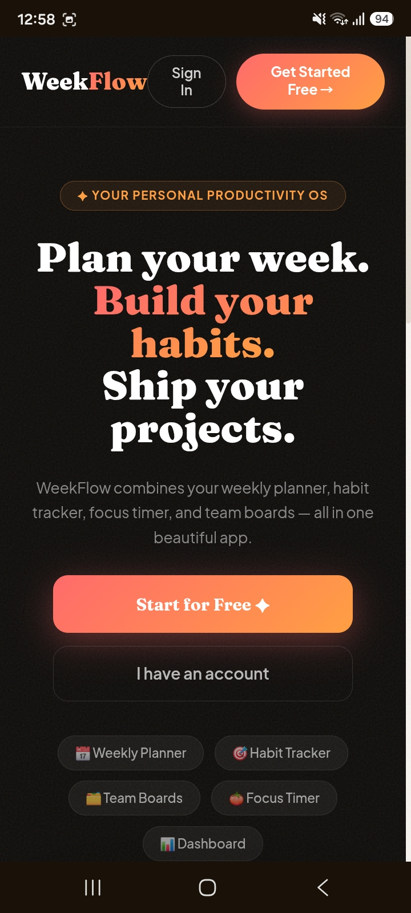
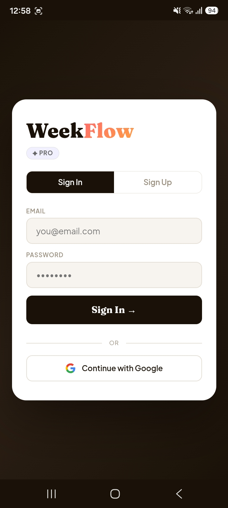
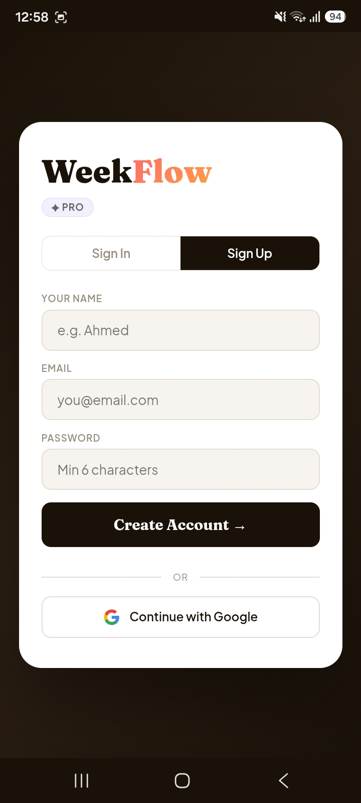
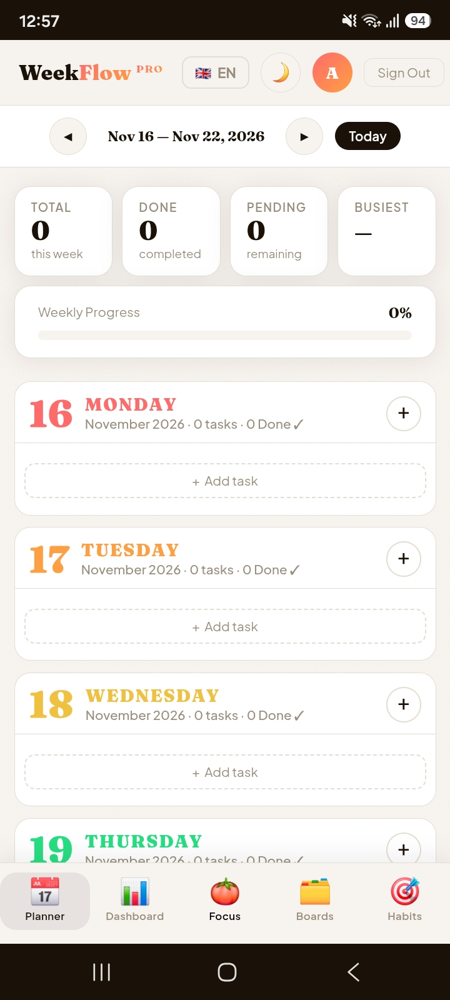
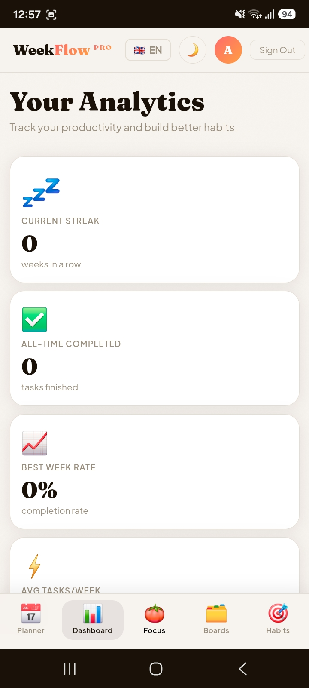
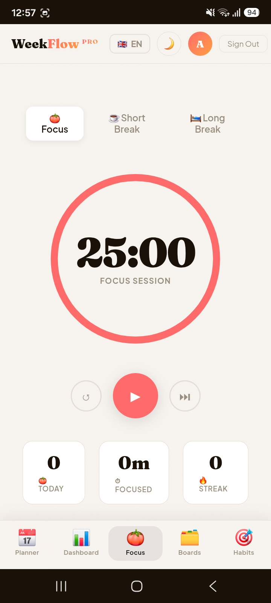
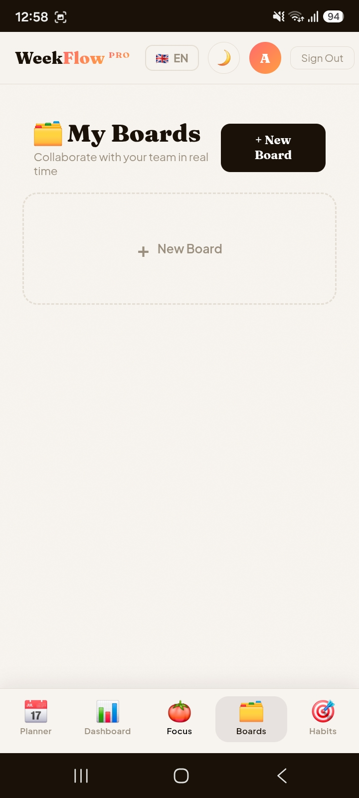
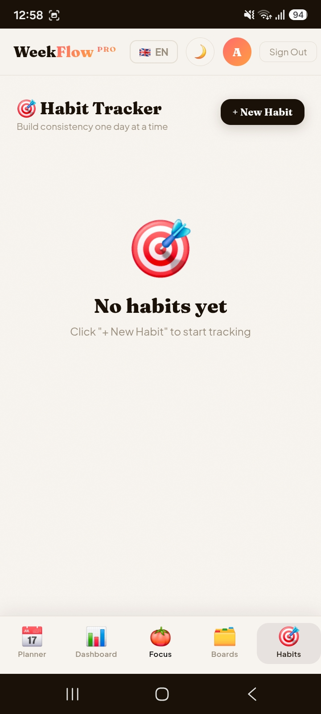

<div align="center">


# WeekFlow Pro

**Plan your week. Build your habits. Ship your projects.**

A free, all-in-one productivity app: weekly planner, habit tracker, Pomodoro focus timer and real-time team boards, available in English, French and Arabic.

[**Live Demo**](https://fedi-mhadhbi.github.io/WeekFlow/) · [Report a Bug](https://github.com/Fedi-Mhadhbi/WeekFlow/issues) · [Request a Feature](https://github.com/Fedi-Mhadhbi/WeekFlow/issues)


</div>

---

## Screenshots

<div align="center">

| Landing page | Sign in | Sign up |
|:---:|:---:|:---:|
|  |  |  |

| Weekly planner | Dashboard | Focus timer |
|:---:|:---:|:---:|
|  |  |  |

| Team boards | Habit tracker |
|:---:|:---:|
|  |  |

</div>

---

## Features

### Weekly Planner
- 7-day view with tasks, priorities, categories and custom categories
- Recurring tasks (daily, weekly, or on a chosen weekday) with a start date and duration
- Smart delete for recurring tasks: remove **only this day**, **this day and all future days**, or the **whole series**
- Search across all weeks
- Swipe-to-delete on mobile, with haptic feedback
- Confetti when you finish every task of the day

### Habit Tracker
- Grid view: one row per habit, one column per day of the current week
- Per-habit color and emoji
- Streak tracking, including a 🔥 badge from 3 days in a row
- Stats cards: weekly completions, best streak and completion rate
- Confetti on a perfect day and a **Perfect Week** badge
- Daily score bar and a mobile layout that fits all 7 days on screen

### Team Boards (Trello-style)
- Shared kanban boards with real-time sync through Firestore
- Custom columns (defaults: To Do, In Progress, Done)
- Drag-and-drop cards between columns
- Cards with title, notes, priority and assignee
- Invite members by email
- Owner-only controls: only the board creator can delete the board, columns or cards

### Focus Timer
- Pomodoro timer (focus, short break, long break)
- Running indicator in the navigation bar

### Dashboard
- Weekly completion chart (based on completed tasks) and productivity stats

### Multilingual (EN / FR / AR)
- Full interface translation, including day and month names
- Right-to-left layout for Arabic
- Language choice is remembered between visits

### Progressive Web App
- Installable on Android, iOS and desktop
- Offline support through a service worker
- Dark mode
- Landing page for new visitors and a guided onboarding tour for first-time users

---

## Tech Stack

| Layer | Technology |
|---|---|
| Frontend | Vanilla HTML, CSS and JavaScript (ES modules), in a single `index.html` |
| Auth | Firebase Authentication (email/password and Google sign-in) |
| Database | Cloud Firestore (real-time listeners) |
| Offline / PWA | Service Worker and Web App Manifest |
| Hosting | GitHub Pages / Netlify (static) |

There is no framework and no build step.

---

## Project Structure

```
WeekFlow/
├── index.html        # The whole app (UI, styles, logic, translations)
├── manifest.json     # PWA manifest
├── sw.js             # Service worker (offline cache)
├── icon-192.png      # App icon
├── icon-512.png      # App icon (also used as maskable)
├── firestore.rules   # Firestore security rules
├── screenshots/      # README images (mobile captures)
└── README.md
```

---

## Getting Started

### 1. Clone the repository

```bash
git clone https://github.com/Fedi-Mhadhbi/WeekFlow.git
cd WeekFlow
```

### 2. Create a Firebase project

1. Go to the [Firebase Console](https://console.firebase.google.com/) and create a project.
2. **Authentication** → Sign-in method → enable **Email/Password** and **Google**.
3. **Firestore Database** → create a database.
4. **Project settings** → Your apps → add a **Web app** and copy the config object.

### 3. Add your Firebase config

In `index.html`, replace the `firebaseConfig` object with your own:

```js
const firebaseConfig = {
  apiKey: "YOUR_API_KEY",
  authDomain: "YOUR_PROJECT.firebaseapp.com",
  projectId: "YOUR_PROJECT",
  storageBucket: "YOUR_PROJECT.appspot.com",
  messagingSenderId: "...",
  appId: "..."
};
```

Add your hosting domain (for example `yourname.github.io`) under **Authentication → Settings → Authorized domains**.

### 4. Set the Firestore rules

Publish the rules from `firestore.rules`. They should cover at least:

```
rules_version = '2';
service cloud.firestore {
  match /databases/{database}/documents {

    // Each user can only access their own data (tasks, habits, settings)
    match /users/{userId}/{document=**} {
      allow read, write: if request.auth != null && request.auth.uid == userId;
    }
    match /users/{userId} {
      allow read, write: if request.auth != null && request.auth.uid == userId;
    }

    // Shared boards
    match /boards/{boardId} {
      allow read: if request.auth != null && (
        resource.data.owner == request.auth.uid ||
        request.auth.token.email in resource.data.memberEmails
      );
      allow create: if request.auth != null && request.resource.data.owner == request.auth.uid;
      allow update: if request.auth != null && (
        resource.data.owner == request.auth.uid ||
        request.auth.token.email in resource.data.memberEmails
      );
      allow delete: if request.auth != null && resource.data.owner == request.auth.uid;
    }
  }
}
```

### 5. Run it

Because the app uses ES modules and a service worker, serve it over HTTP instead of opening the file directly:

```bash
# any static server works
npx serve .
# or
python3 -m http.server 8000
```

Then open `http://localhost:8000`.

### 6. Deploy

Push to GitHub and enable **GitHub Pages** (Settings → Pages → deploy from branch), or drag the folder into Netlify. After a deploy, reload twice: the service worker shows the cached version first, then updates it in the background.

---

## Installing as an app

| Platform | How |
|---|---|
| Android (Chrome) | Open the site, wait a few seconds for the install banner, or menu (⋮) → *Add to Home screen* |
| Desktop (Chrome / Edge) | Click the install icon (⊕) in the address bar |
| iPhone (Safari) | Share button → *Add to Home Screen* (iOS does not allow an automatic prompt) |

---

## Data Model (Firestore)

```
users/{uid}                      → templates, settings, recurringTasks
users/{uid}/weeks/{weekKey}      → days: { 0..6: [task, ...] }
users/{uid}/habits/data          → habits: [...], logs: { "habitId_YYYY-MM-DD": true }
boards/{boardId}                 → name, color, owner, memberEmails[], members[], columns[]
```

---

## Roadmap

- [ ] Card due dates and checklists in boards
- [ ] Board activity log
- [ ] Profile page and password reset
- [ ] Habit heatmap and weekly report card
- [ ] Push reminders for habits
- [ ] Mobile touch drag-and-drop for board cards

---

## Contributing

Suggestions and bug reports are welcome. Open an [issue](https://github.com/Fedi-Mhadhbi/WeekFlow/issues) or submit a pull request.

---

## Author

**Fedi Mhadhbi**: [GitHub](https://github.com/Fedi-Mhadhbi)

---

<div align="center">

Made with ❤️ · Free forever · No ads

</div>
